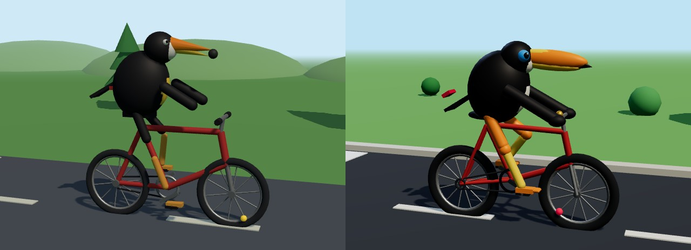

# Looks Right, Moves Wrong

**Can a language model repair a 3D bird on a bike?** A toucan can have moving feet and moving pedals without the two ever meeting. A browser measured each model's own program; the same model then had three chances to repair it. Across 36 shared starts, 13 first drafts ran and met the course rules, versus 34 with the harness. Only five scenes passed every mechanical check. All five were bicycles.

[Watch the M02 comparison](showcase/videos/M02.webm) · [Read the two-reviewer results](data/tables/Human-review.md) · [Inspect every endpoint](data/tables/endpoints.csv) · [Read the frozen protocol](artifacts/final-study/protocol/objective-study.json)



## Reproduce the published numbers — offline, one command

From the repository root, with Python 3.10 or newer:

```sh
python3 reproduce.py
```

No packages, browser, model key or API call are needed. The command checks the hashes of the 26 registered source files, archive contents against the candidate/phase indices, budgets and model identities; it reselects each of the 144 endpoints from its eligible candidates using the archived browser measurements. It then redecodes the anonymous ballots using the side key and checks the judge's calibration. It fails on a disagreement with the registered outcome tables. This rebuilds the analysis from recorded observations; it does not pretend to regenerate the exact same stochastic HTML from an API.

| Condition | Extra proposals per start | Runnable / 36 | All mechanics / 36 |
|---|---:|---:|---:|
| A · shared first draw | 0 | 13 (36.1%) | 0 |
| B · independent redraw | 3 | 25 (69.4%) | 0 |
| C · independent redraw with shared skeleton | 3 | 28 (77.8%) | 0 |
| D · same skeleton, targeted repair with measured feedback | 3 | 34 (94.4%) | 5 (13.9%) |

| Formal generator and repairer | D runnable / 12 | D mechanics / 12 |
|---|---:|---:|
| `qwen4-max` | 12 | 4 |
| `deepseek-v4.1-flash-1017` | 12 | 1 |
| `qwen3.8-flash` | 10 | 0 |

Toucan/ostrich × bicycle/tricycle × three independent starts per model. The rig has no constructor for either bird; neither appeared in previous project-generated scenes. A toucan was mentioned in an unexecuted plan/test. This is project-level transfer, not evidence about pretraining. The same original remains eligible in B/C/D. D versus C tests startup repair, targeted revision and mechanical feedback **together**. No model scored formal aesthetics. Across both humans: D–A 15 wins, 2 losses, 3 ties, 4 unclear; D–C 14, 4, 5, 1. Exact agreement 13/24; both reviewers 3/3 consistent on hidden side swaps. Each contrast has 12 unique pairs and 24 votes; repeats are excluded. Calibration was separate from the three-model study: only Qwen4-Max was tested as judge, before the formal run. It changed preference on 9/12 reserved core pairs after the sides were reversed.

## What to open

| Path | Contents |
|---|---|
| `showcase/index.html` | Double-click after downloading the repo. Select **Motion comebacks → M02 · Two feet, two pedals** (C vs. D; formal) and **3D fail museum → F01 · Pancake wheels**. M03 has a separately labeled post-study version; never include it in formal counts. |
| `web/draft-2-motion/`, `web/draft-6-motion/` | Development pelicans from the original course brief: HTML, preview and historical comparison films. Separate from the 36 formal transfer starts. |
| `data/tables/` | Endpoints, aggregate and per-task tables, usage ledger, human results and calibration judgments. `W/L/T/?` always refers to D's win/loss, a tie, or an unclear verdict. |
| `data/ballots/`, `data/review-deck/` | Both timestamp-free anonymous ballots, the side key (for **after** rating), and the original synchronized viewing decks with 24 unique comparisons and three hidden reversals. The original rating interface is in Chinese. The English [rubric](data/rubric.md) explains its four choices. |
| `evidence/*-programs.zip` | All 350 admitted formal HTML programs, byte-for-byte, grouped by model/case/slot. Ten additional responses did not yield an accepted HTML file; all ten remain in the denominator. See `data/rejected-candidates.json`. |
| `evidence/*-traces.zip` | Every formal request body and returned **answer text** (including the ten rejected candidates), all 360 measured outcomes, and available startup logs, repair decisions and per-frame geometric traces. Provider authentication, signed/internal reasoning blocks and provider response IDs are not distributed. The official call ledger preserves original request digests; one published request has a private stack-path prefix removed. |
| `evidence/*-frames.zip`, `data/frames.csv` | Compact JPEGs from archived selections, identified by model, case, slot, arm, view and phase. Each index row gives both the original PNG digest and delivered JPEG digest. Registered hero/detail/reverse captures use 12 fixed times at 4/24-second intervals; failed launches use native captures when available. If there was never a frame, there is none to show. Reused selections share source images. |
| `data/candidates.jsonl`, `data/candidate-index.csv` | Candidate check flags and HTML digests, arm membership and all candidate locations. The 360 request bodies can also be used to inspect exactly what the repair model saw. |
| `artifacts/final-study/protocol/` | The actual formal contract is **`objective-study.json`**. `limits.json` registers the 32,000-token cap. Earlier files, including `gate.json`, document the retired judge; the closed visual gate is not a failed or incomplete formal run. |
| `redesign/`, `lab/`, `scripts/`, `prompts/` | Original frozen harness and its dependencies. Use the **`final run`** entry point below, not the older pilot commands, prompt limits or conditions found in historical modules. |

## Inspect an interactive scene or replay its browser checks

A ready-to-play example of the original pelican brief, with the included offline Three.js dependencies:

```sh
python3 -m http.server 8000 --bind 127.0.0.1 --directory web
```

Open `http://127.0.0.1:8000/draft-6-motion/scene.html` in a browser. For the video-only transfer gallery, no server is required. For a formal scene, use `data/tables/endpoints.csv` to find its selected `slot`, then extract the corresponding HTML from the model's programs archive. For example, to rerun just the isolated **startup/camera** capture for M02-D (not its mechanical grade):

```sh
npm ci && npm run setup
npx playwright install chromium
python3 -m zipfile -e evidence/qwen4-max-programs.zip replay-inputs
node scripts/capture.mjs --html replay-inputs/toucan-bicycle-02/D/try-3/scene.html --out replay-output/M02-D
```

Fresh renders may differ with hardware/browser. The study used Chrome 142.0.7444.176 on macOS and the pinned `three` 0.180.0 / `playwright` 1.56.1. Use a recent Node.js (22.12+); on macOS install Google Chrome because the original probes request the Chrome channel. Raw capture trees and full-resolution movies of every attempt are not shipped. The traces include the actual returned source, observations and camera parameters; use the frozen sampler below to regenerate registered views for any admitted scene.

```sh
node scripts/final_phase_views.mjs replay-inputs/toucan-bicycle-02/D/try-3/scene.html replay-output/M02-phases auto one
```

## Optional: a fresh, paid model replication

This is **not** the one-command offline audit. In a separate, fresh checkout on Linux or macOS, install the pinned dependencies with `python3 -m pip install -r requirements-rides.txt`, `npm ci`, `npm run setup` and `npx playwright install chromium` (Chrome on macOS). Supply the authorized DashScope Anthropic-compatible credential using your own environment variable `ANTHROPIC_AUTH_TOKEN`. The provider base URL and model IDs are configured in the repository; do not put a credential in a file or commit it. Then run:

```sh
python3 -u redesign/formal_rides.py final run
```

The frozen command registers/resumes 36 starts under `artifacts/final-study/cases/`. Each model uses its own generator and repairer, with 32,000 output tokens per request, temperature 0.7 for A/B/C, 0.3 for D. Output decisions: 360. Recorded input/output usage: 1,008,375 / 2,789,029 tokens; median provider time per completed request: 89.2 seconds. The live service, access and model revisions can change. New draws can differ; never overwrite the released measurements with a new run. Other scripts in this repo originate from the frozen research code, including historical tooling: `reproduce.py` is the supported release analysis entry point.

## Scope and attribution

This project began with the [CUHK-Shenzhen NLP course A1 challenge](https://nlp-course-cuhksz.github.io/final-project.html) and its adaptation of the pelican-on-a-bicycle prompt. The two authors jointly conducted the project and independently rated its outputs. Codex assisted with software, analysis, figures and writing. Formal repairs were made only by the corresponding study model. Quantitative preferences describe the selected pairs, not all possible generators or raters. The shared rig handles vehicle geometry; this is not a general physics simulator. Third-party Three.js is distributed under its [MIT license](web/vendor/LICENSE).
